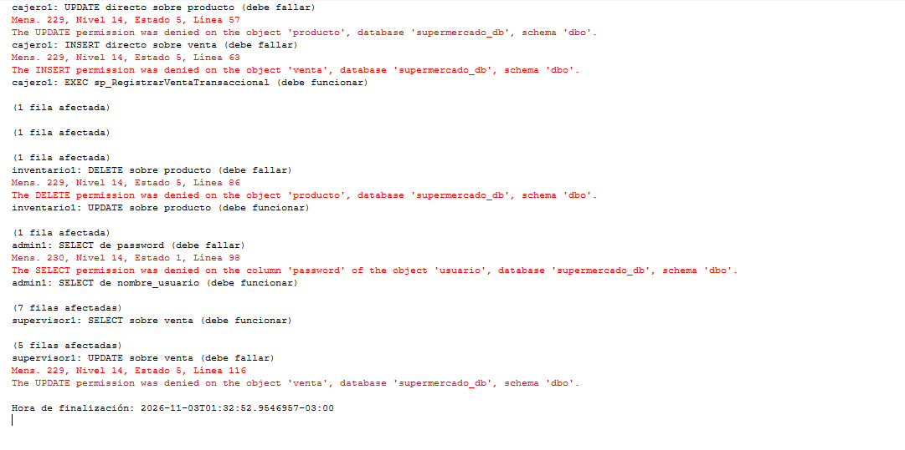
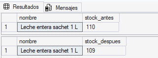

# Seguridad: usuarios, roles y permisos

## ¿Que es?

La seguridad de una base de datos define quién puede entrar y qué puede hacer. En SQL Server se manejan permisos que se pueden dar a un usuario o a un rol, que es un grupo de permisos al que se le agregan usuarios. La idea es el mínimo privilegio: cada uno tiene solo lo que necesita para trabajar.

Para nuestro sistema sirve para que las reglas de los roles que definimos en la etapa 1 no dependan solo de la aplicación. Si alguien se conecta directo a la base, SQL Server igual rechaza lo que su rol no permite. Además protege datos sensibles (como las contraseñas), evita cambios por error y permite administrar los permisos en un solo lugar.

## Como lo hacemos

Un **login** es la credencial para entrar al servidor, un **usuario** es esa identidad dentro de la base y un **rol** agrupa permisos. Los permisos se dan con `GRANT`, se niegan con `DENY` (que gana sobre cualquier `GRANT`) y se quitan con `REVOKE`.

```sql
CREATE LOGIN cajero_ejemplo WITH PASSWORD = '...';
CREATE USER cajero1 FOR LOGIN cajero_ejemplo;
CREATE ROLE rol_cajero;
GRANT SELECT ON dbo.producto TO rol_cajero;
ALTER ROLE rol_cajero ADD MEMBER cajero1;
```

Creamos un rol por cada rol del sistema, con el prefijo `rol_` para no confundirlo con la tabla `rol`:

| Rol | Permisos | Regla |
| --- | --- | --- |
| `rol_cajero` | `SELECT` sobre `producto`, `categoria` y `medio_de_pago`. Registra ventas solo con `EXECUTE` sobre `sp_RegistrarVentaTransaccional` y el tipo `DetalleVentaTransaccional`. | RN.03, RN.05 |
| `rol_inventario` | `SELECT`, `INSERT` y `UPDATE` sobre `producto` y `categoria`, y `SELECT` sobre `unidad_medida`. Sin `DELETE`. | RN.06 |
| `rol_administracion` | `SELECT`, `INSERT` y `UPDATE` sobre `usuario` y `persona`, y `SELECT` sobre `rol`. `DENY SELECT` sobre `usuario.password`. | RN.01, RN.02, RN.06 |
| `rol_supervisor` | `SELECT` sobre `venta`, `detalle_venta` y `producto`. | RN.08 |

Ningún rol tiene `DELETE` porque las bajas son lógicas (`UPDATE` de `eliminado_en`).

El caso más interesante es el del cajero. No puede modificar `producto` ni insertar en `venta`, pero registra ventas igual a través del procedimiento. Esto funciona porque el procedimiento y las tablas están en el esquema `dbo`, y SQL Server solo revisa el permiso de ejecución (encadenamiento de propietarios). El permiso sobre el tipo `DetalleVentaTransaccional` hace falta porque el procedimiento recibe la lista de productos como parámetro de tipo tabla.

## Script y pruebas

El script está en [sql/tecnico/seguridad/seguridad_permisos_roles.sql](../../sql/tecnico/seguridad/seguridad_permisos_roles.sql)(../../sql/tecnico/seguridad/seguridad_permisos_roles.sql). Crea los roles, los permisos y un usuario de ejemplo por rol (`cajero1`, `inventario1`, `admin1` y `supervisor1`), y a continuación las pruebas. Se corre después de `transacciones.sql`, porque otorga permisos sobre el procedimiento y el tipo que se crean ahí. Al final tiene una sección de limpieza que borra los usuarios, roles y logins de ejemplo (al borrar los roles también se van sus permisos), así el script se puede volver a correr desde cero.

Cada prueba se hace como el usuario correspondiente con `EXECUTE AS USER` y se vuelve con `REVERT`. Las que deben fallar usan `precio = precio` o `WHERE 1 = 0`, para no cambiar datos reales si el permiso existiera por error.

```sql
EXECUTE AS USER = 'cajero1';
UPDATE dbo.producto SET precio = precio WHERE id_producto = 1;
REVERT;
```

## Resultados

| Usuario | Prueba | Esperado | Obtenido |
| --- | --- | --- | --- |
| `cajero1` | `UPDATE` directo sobre `producto` | Denegado | Denegado (error 229) |
| `cajero1` | `INSERT` directo sobre `venta` | Denegado | Denegado (error 229) |
| `cajero1` | `EXEC sp_RegistrarVentaTransaccional` | Venta registrada | Correcto. Stock de leche: 110 -> 109 |
| `inventario1` | `UPDATE` sobre `producto` | Correcto | Correcto |
| `inventario1` | `DELETE` sobre `producto` | Denegado | Denegado (error 229) |
| `admin1` | `SELECT` de `password` | Denegado | Denegado (error 230) |
| `admin1` | `SELECT` de `nombre_usuario` | Correcto | Correcto |
| `supervisor1` | `SELECT` sobre `venta` | Correcto | Correcto |
| `supervisor1` | `UPDATE` sobre `venta` | Denegado | Denegado (error 229) |





Los resultados son los esperados. El `SELECT` de `password` da error 230 y no 229 porque el `DENY` está sobre la columna y no sobre la tabla.

## A tener en cuenta

- Las contraseñas del script son solo de demostración.
- La prueba del cajero registra una venta real de 1 leche cada vez que se corre.
- Como la limpieza está al final, cuando termina de correr el script los roles y usuarios ya no existen. Si se quieren dejar creados para probar a mano, hay que correr solo hasta antes de la sección de limpieza. Y si el script se corta a la mitad y quedan objetos creados, hay que correr la sección de limpieza antes de volver a empezar.
- Si una prueba falla y no llega al `REVERT`, la sesión de SSMS queda ejecutando como ese usuario y lo que se corra después falla por falta de permisos. Nos pasó con el cajero. Se arregla ejecutando `REVERT;`.
- La regla RN.08 no se puede resolver con un `GRANT` sobre `detalle_venta`, porque un permiso de tabla no distingue el estado de la venta. Haría falta un procedimiento. Por ahora el supervisor solo consulta.
